# DEVELOPMENT OF A WEB-BASED MICRO HEALTH INSURANCE SYSTEM FOR LOW-INCOME PHARMACY CLIENTS IN KAMPALA

**System Name:** AfyaMicro Kampala  
**Institution:** Makerere University Business School (MUBS)  
**Faculty:** Faculty of Computing and Informatics  
**Department:** Department of Applied Computing  
**Degree Programme:** Bachelor of Business Computing (Makerere University)  
**Supervisor:** Mrs. Maria Miiro Kafuko  
**Date:** September, 2026  

---

## Group Members

| Name | Registration Number | Phone Number |
|---|---|---|
| Katongole Erisa | 24/U/05484/PS | +256-767269901 |
| Ekii Jesse Ryan | 24/U/0381 | +256-773190362 |
| Kyeyune Elvis | 24/U/16368/EVE | +256-705711566 |
| Ainemukama Trevor | 24/U/02969/PS | +256-753305903 |
| Lubwama Erick Mpanga | 24/U/06468/PS | +256-706108195 |

---

## DECLARATION

We hereby declare that this project report and the accompanying software system are our original work, and have never been published or submitted to any other university or higher learning institution for any academic award.

| Name | Registration Number | Signature |
|---|---|---|
| Katongole Erisa | 24/U/05484/PS | ______________________ |
| Ekii Jesse Ryan | 24/U/0381 | ______________________ |
| Kyeyune Elvis | 24/U/16368/EVE | ______________________ |
| Ainemukama Trevor | 24/U/02969/PS | ______________________ |
| Lubwama Erick Mpanga | 24/U/06468/PS | ______________________ |

**Date:** ____________________________

---

## APPROVAL

This project report and software artifact have been submitted with my approval as academic supervisor, and my signature is here appended:

**Signed:** _______________________________  **Date:** _________________________  
**Mrs. Maria Miiro Kafuko**  
Department of Applied Computing  
Makerere University Business School  

---

## LIST OF ABBREVIATIONS

| Abbreviation | Meaning |
|---|---|
| ACID | Atomicity, Consistency, Isolation, Durability |
| APA | American Psychological Association |
| BBC | Bachelor of Business Computing |
| CSRF | Cross-Site Request Forgery |
| CSS / CSS3 | Cascading Style Sheets (Level 3) |
| DFD | Data Flow Diagram |
| DSR | Design Science Research |
| EAT | East Africa Time (`UTC+03:00`) |
| ERD | Entity-Relationship Diagram |
| FK | Foreign Key |
| HTML / HTML5 | HyperText Markup Language (Version 5) |
| HTTP / HTTPS | HyperText Transfer Protocol (Secure) |
| ILO | International Labour Organization |
| JS | JavaScript |
| KCCA | Kampala Capital City Authority |
| MHI | Micro Health Insurance |
| MoH | Ministry of Health (Uganda) |
| MoMo | MTN Mobile Money |
| MUBS | Makerere University Business School |
| NDA | National Drug Authority |
| NIN | National Identification Number |
| PDO | PHP Data Objects |
| PHP | Hypertext Preprocessor (PHP 8) |
| PK | Primary Key |
| PRG | Post/Redirect/Get |
| RBAC | Role-Based Access Control |
| SDLC | Systems Development Life Cycle |
| SQL | Structured Query Language |
| UCC | Uganda Communications Commission |
| UGX | Ugandan Shillings |
| UI / UX | User Interface / User Experience |
| UK | Unique Key |
| WHO | World Health Organization |
| XAMPP | Cross-Platform Apache, MariaDB, PHP, and Perl |

---

## ABSTRACT

Low-income urban residents in Kampala frequently struggle to afford full prescriptions out-of-pocket at community pharmacies, while partner pharmacies rely on manual books or basic point-of-sale tools incapable of tracking micro-insurance savings, verifying client cover, or splitting partial co-payments. To address this gap, this project designed, implemented, and validated **AfyaMicro Kampala**, a web-based micro health insurance system tailored for low-income pharmacy clients across Kampala. The study pursued four specific objectives: (i) investigating the financial, operational, and technological barriers faced by low-income pharmacy clients and attendants; (ii) specifying functional, non-functional, user, and system requirements; (iii) designing and developing a three-tier web portal supporting client registration, flexible mobile-money micro-deposits, real-time wallet balances, and atomic counter claim deductions; and (iv) validating functionality, usability, and reliability through structured test cases. Following the Design Science Research (DSR) methodology (Hevner, March, Park, & Ram, 2004), requirements were elicited via pharmacy stakeholder interviews, counter observation, and document review, and translated into Data Flow Diagrams, Use Cases, a five-table Entity-Relationship Diagram, and a responsive XAMPP application powered by PHP 8 (PDO), MariaDB/MySQL (`micro_health_db`), HTML5, CSS3, and Vanilla JavaScript. Validation results confirmed that all four objectives were fulfilled: client self-registration generated unique `MHI-KLA-XXXX` policies atomically, simulated MTN MoMo, Airtel Money, and Cash Agent deposits updated `total_contributed` and `available_balance` accurately, attendant claim processing enforced `SELECT ... FOR UPDATE` row locking to split `covered_amount` and `client_copay` cleanly while rejecting zero-balance wallets, printable `80mm` thermal receipts were produced, and all 52 backend integration checks plus 24 end-to-end UI tests passed without errors.

---

## TABLE OF CONTENTS

- **Preliminary Pages:** Declaration · Approval · List of Abbreviations · Abstract
- **Chapter One:** Introduction (1.0–1.6)
- **Chapter Two:** Literature Review (2.0–2.7)
- **Chapter Three:** Research Methodology (3.0–3.8)
- **Chapter Four:** Systems Analysis and Design (4.0–4.5)
- **Chapter Five:** Systems Development and Presentation (5.0–5.2)
- **Chapter Six:** Evaluation, Validation and Recommendations (6.0–6.5)
- **References**
- **Appendices** (Appendices I–V)

---

# CHAPTER ONE: INTRODUCTION

## 1.0 Introduction

This chapter presents the contextual foundation of the study, the problem that motivated the development of **AfyaMicro Kampala**, the overarching project goal, the four specific objectives pursued, the conceptual, geographical, and temporal scope of the work, and the significance of the resulting system to Kampala clients, community pharmacies, and future researchers.

## 1.1 Background to the Study

Digital financial technologies have transformed how households and small enterprises manage everyday transactions across developing economies. In Uganda, rapid expansion in mobile money adoption, internet connectivity, and browser-accessible payment services has created a reliable foundation for inclusive digital health financing solutions serving low-income earners (GSMA, 2023; Uganda Communications Commission [UCC], 2025).

Community pharmacies across Kampala serve residents across diverse income brackets, including daily wage earners, market vendors, and informal-sector households who frequently lack sufficient cash at the point of illness to purchase full medication regimens. In dense commercial and residential areas such as Kisenyi, Kawempe, and Katwe, many community pharmacies still rely on manual paper notebooks or basic sales registers that cannot manage recurring client micro-contributions, verify active insurance coverage, or compute partial co-payments accurately.

To close this operational gap, this project designed, implemented, and tested a web-based micro health insurance platform named **AfyaMicro Kampala**. Through responsive web portals connected to a centralized relational database, clients registered free of charge, contributed small flexible amounts via MTN MoMo, Airtel Money, or local Cash Agents, monitored real-time wallet balances, and redeemed prescribed medication at accredited partner pharmacies with automated co-pay verification.

## 1.2 Statement of the Problem

Ideal community healthcare financing enables low-income households to build modest health savings gradually and redeem essential medicines without financial shock or administrative friction (International Labour Organization [ILO], 2021; World Health Organization [WHO], 2020). However, low-income pharmacy clients in Kampala routinely face difficulties paying for full prescriptions out-of-pocket, while conventional insurance schemes remain inaccessible due to high upfront premiums, rigid paperwork, and complex enrolment requirements, and community pharmacies lack automated systems to track client contributions, verify real-time balances, or adjudicate claims (Ministry of Health Uganda [MoH], 2020; World Bank, 2022). Consequently, clients often purchase incomplete doses or skip treatment altogether, exposing households to worsening illness and pharmacies to uncollected balances and manual reconciliation errors. To address these gaps, this project designed and implemented **AfyaMicro Kampala**, a secure, role-based web portal and centralized database system enabling simple client registration, flexible mobile-money micro-deposits, instant counter eligibility verification, and auditable claim deduction.

## 1.3 Purpose of the Study

The general objective of this project was to design, implement, and validate a web-based micro health insurance system (**AfyaMicro Kampala**) for low-income pharmacy clients and partner community pharmacies in Kampala.

## 1.4 Specific Objectives of the Study

The study achieved its purpose through four specific objectives:
1. To investigate the financial, operational, and technological challenges faced by low-income pharmacy clients and pharmacy staff in accessing and administering micro health insurance services in Kampala.
2. To identify and specify the functional, non-functional, user, and technical system requirements of a web-based micro health insurance system.
3. To design and develop the web-based micro health insurance system supporting client registration, secure tracking of micro-premium deposits, real-time wallet balance checks, atomic prescription claim deductions with co-payment calculation, and administrative reporting.
4. To test and validate the functionality, usability, security, and reliability of the developed system using structured test cases.

## 1.5 Study Scope

### 1.5.1 Conceptual Scope
The project focused on the analysis, architectural design, full-stack implementation, and test-case validation of a responsive web-based micro health insurance platform covering three operational roles: Low-Income Clients (self-registration, policy issuance, mobile-money/cash-agent micro-deposits, wallet and claim history), Pharmacy Attendants (phone/policy lookup, eligibility verification, atomic claim deduction, co-pay split calculation, and printable thermal receipts), and Scheme Administrators (KPI dashboards, partner pharmacy onboarding, and filtered contribution/claim audit reporting).

### 1.5.2 Geographical Scope
The study focused on community pharmacies serving low-income urban and peri-urban populations in Kampala, Uganda, modeled around representative high-density divisions including **Kisenyi** (Kampala Central Division), **Kawempe** (Kawempe Division), and **Katwe** (Makindye Division).

### 1.5.3 Time Scope
The study and software development lifecycle were executed over an eight-week period covering proposal formulation and requirements gathering (Weeks 1–2), system analysis and database design (Week 3), full-stack prototype development (Weeks 4–6), integration testing and user feedback (Week 7), and final documentation compilation (Week 8), concluding in September 2026.

## 1.6 Justification and Significance of the Study

For **low-income Kampala clients**, the system lowered barriers to medication access by permitting small, flexible savings without monthly lock-in penalties and preserving exact transparency over contributed funds and pharmacy deductions. For **partner community pharmacies**, AfyaMicro replaced error-prone paper ledgers with instant phone or policy lookup, automatic co-pay calculation, and printable thermal receipts (`CLM-XXXXXX`) that eliminated counter disputes. For **healthcare financing practitioners and researchers**, the project demonstrated how lightweight open-source LAMP/XAMPP technologies (PHP 8 PDO and InnoDB row locking) can enforce financial-grade ACID integrity in resource-constrained urban retail healthcare settings. For the **MUBS student team**, the project bridged academic coursework in Systems Analysis and Design, Corporate Database Management, and Web Development with an applied social-impact prototype.

---

# CHAPTER TWO: LITERATURE REVIEW

## 2.0 Introduction

This chapter reviews existing scholarly and policy literature aligned with the study objectives, examining mobile health and digital financial inclusion, responsive web technologies, micro health insurance models for low-income populations, pharmacy-based health financing, system design considerations, and implementation challenges in urban Sub-Saharan Africa.

## 2.1 Mobile Health and Digital Financial Inclusion

Mobile health encompasses the delivery of healthcare information, clinical support, and health financing mechanisms through connected personal devices, extending reach to populations historically underserved by brick-and-mortar institutions. Digital financial inclusion complements mobile health by equipping low-income citizens without traditional bank accounts with accessible digital wallets and electronic payment channels (GSMA, 2023). Across Sub-Saharan Africa, mobile money infrastructure has enabled low-income households to accumulate micro-savings incrementally rather than relying exclusively on distress borrowing or cash reserves at the point of need (GSMA, 2023). Within Kampala’s urban pharmacy ecosystem, pairing mobile-money micro-contributions with health wallets offered a practical pathway to shield low-income households from sudden out-of-pocket medication shocks while building verifiable transaction histories.

## 2.2 Web-Based Technologies and Access to Digital Services

Web-based architectures allow diverse user groups—clients, pharmacy counter attendants, and scheme administrators—to access shared operational workflows simultaneously across smartphones, tablets, and desktop browsers without requiring platform-specific app store installations (World Health Organization [WHO], 2021). In urban centres across Uganda, sustained expansion in mobile broadband penetration and browser-capable smartphones has positioned responsive web applications as an increasingly viable delivery channel for inclusive digital health services (Uganda Communications Commission [UCC], 2025). Unlike character-limited text menus such as legacy USSD sessions, modern web applications support rich visual dashboards, encrypted session cookies, multi-field prescription entry, itemized audit tables, and instant receipt printing, making them better suited to complex micro-insurance workflows involving co-payment logic and multi-table database integrity (GSMA, 2023).

## 2.3 Micro Health Insurance for Low-Income Clients

Micro health insurance provides low-cost health risk protection tailored to informal-sector and low-income earners who cannot sustain steep annual or monthly commercial insurance premiums (International Labour Organization [ILO], 2021). By allowing policy holders to make small, irregular contributions matched to daily or weekly earnings, micro health insurance reduces financial anxiety and prevents patients from abandoning essential treatments mid-course due to cash shortages at the point of care (ILO, 2021). When integrated directly with retail drug dispensing, savings-backed micro-insurance policies ensure that accumulated contributions remain earmarked specifically for verified prescriptions rather than being diverted to competing household expenses, thereby improving both medication adherence and household financial resilience.

## 2.4 Pharmacy-Based Health Financing Services

Retail community pharmacies represent the most accessible first point of clinical contact for acute primary health complaints across urban Uganda, supplying essential medicines, dosing guidance, and symptomatic triage before households incur higher hospital outpatient costs (Ministry of Health Uganda [MoH], 2020). Despite their central role in community healthcare delivery, many neighbourhood pharmacies operate with manual stock books or standalone cash-register tools that cannot verify patient insurance coverage, record earmarked health contributions, or split pharmacy bills between insurer payouts and client cash co-payments (MoH, 2020). Embedding a lightweight web-based counter checkout tool directly inside partner pharmacies transformed the dispensing counter into an active micro-insurance redemption point without disrupting existing clinical workflows.

## 2.5 Design of Web-Based Micro Health Insurance Systems

Effective digital health financing platforms require clear, low-friction navigation, unambiguous user role segregation, real-time contribution tracking, reliable eligibility lookup, and normalized backend persistence linking clients, policies, deposits, pharmacies, and claims (WHO, 2020). Because target beneficiaries include low-income earners operating entry-level smartphones and busy counter attendants processing queues, interfaces must minimize form complexity, provide clear validation feedback, and display monetary amounts in familiar local formats such as Ugandan Shillings. At the data layer, strict relational integrity, parameterized queries, and atomic balance updates ensure that simultaneous deposits and counter claims never produce negative or inconsistent wallet balances (WHO, 2020).

## 2.6 Challenges in Implementing Web-Based Micro Health Insurance Systems

Deploying digital micro-insurance systems in low-income retail environments encounters several recurring socio-technical obstacles, including low institutional trust in new financial tools, limited digital literacy among elderly clients, irregular contribution patterns, resistance among pharmacy staff accustomed to paper ledgers, and data-entry errors during busy counter hours (World Bank, 2022). Literature indicates that these barriers are effectively mitigated through iterative prototyping with end users, transparent transaction confirmation receipts, human-readable error prompts, role-tailored training, and clear audit trails that allow both clients and administrators to verify every shilling contributed or claimed (World Bank, 2022).

## 2.7 Conclusion

The reviewed literature established that expanding mobile connectivity and digital financial rails in Kampala (GSMA, 2023; UCC, 2025) created fertile ground for responsive web-based micro health insurance tailored to community pharmacies (MoH, 2020; WHO, 2021). Combining flexible micro-deposits (ILO, 2021) with simple, secure counter workflows (WHO, 2020) and transparent validation receipts directly addressed the financial and operational barriers documented across low-income healthcare settings (World Bank, 2022).

---

# CHAPTER THREE: RESEARCH METHODOLOGY

## 3.0 Introduction

This chapter details the research methodology executed to investigate the problem and construct **AfyaMicro Kampala**, covering the Design Science Research framework, target population, sampling strategy, data sources, requirement elicitation techniques, system analysis and development approach, and ethical safeguards observed.

## 3.1 Research Design

The study adopted the **Design Science Research (DSR)** methodology as formalized by Hevner, March, Park, and Ram (2004). DSR is specifically suited to applied information systems projects whose primary contribution is the creation and rigorous evaluation of a purposeful IT artifact designed to solve an identified organizational and societal problem. In accordance with DSR guidelines, the team executed five iterative phases: (1) problem identification and motivation within Kampala retail pharmacies; (2) definition of system objectives and requirements; (3) design and architectural modeling of the database and web controllers; (4) construction of the working **AfyaMicro Kampala** web prototype; and (5) functional, security, and usability evaluation using repeatable integration test cases.

## 3.2 Study Population

The study population comprised four stakeholder groups integral to Kampala community pharmacy financing: community pharmacy owners (business decision-makers), counter pharmacy attendants (dispensing staff), low-income pharmacy clients (urban earners seeking affordable medication cover), and scheme administrators overseeing multi-pharmacy reconciliation. Operational context was grounded in three representative Kampala zones: Kisenyi (Kampala Central Division), Kawempe (Kawempe Division), and Katwe (Makindye Division).

## 3.3 Sampling Design and Techniques

The team applied **purposive sampling** to engage pharmacy owners and counter attendants because their frontline operational knowledge of prescription abandonment, partial cash sales, and manual record keeping was essential to defining claim and receipt workflows. **Convenience sampling** was applied when gathering user-interface expectations from walk-in pharmacy clients regarding phone-based registration, preset deposit amounts, and mobile-money familiarity.

## 3.4 Sources of Data

Both **primary** and **secondary** data sources informed the system specification. Primary data were obtained through structured interviews with pharmacy personnel and low-income clients alongside direct observation of counter dispensing interactions. Secondary data were drawn from peer-reviewed information systems literature and institutional reports published by GSMA (2023), WHO (2020, 2021), ILO (2021), UCC (2025), Ministry of Health Uganda (2020), and the World Bank (2022).

## 3.5 Requirement Elicitation Techniques

Requirements were elicited using three complementary techniques:
- **Structured Interviews:** Guided by the interview instruments in Appendices I and II to uncover how pharmacies currently handle under-funded prescriptions, which client identifiers (phone number, NIN, policy number) are practical at the counter, and what security safeguards build client trust.
- **Direct Counter Observation:** Observing pharmacy checkout sequences to identify timing bottlenecks and design the two-field claim deduction flow (`prescription_notes` and `total_cost`) with real-time JavaScript co-pay previews.
- **Document & Schema Review:** Analyzing National Drug Authority (NDA) pharmacy licensing identifiers, Ugandan phone number conventions (`07XXXXXXXX`), and UGX mobile-money reference patterns (`MTN MoMo`, `Airtel Money`).

## 3.6 System Analysis and Design Approach

System analysis combined **structured process modeling** (Context Diagram, Level-1 Data Flow Diagram, and end-to-end decision flowcharts) with **modular component decomposition** and **relational database normalization (3NF)**. Modularizing the backend into isolated bootstrap middleware (`config/`), read-only query fetchers (`*/fetch_data.php`), and transactional POST controllers (`*_process.php`) enabled clean separation between UI presentation and financial business logic.

## 3.7 System Development Approach

The team followed an **iterative prototyping** approach within the Systems Development Life Cycle (SDLC) on a local **XAMPP** stack (Apache, MariaDB/MySQL 10.4, PHP 8.2). Building an early database contract (`BACKEND_CONTRACT.md`) allowed backend PDO controllers and the mobile-first HTML5/CSS3/Vanilla JS frontend to be developed iteratively, verified against realistic Kampala seed data, and refined visually based on counter usability checks.

## 3.8 Ethical Considerations

All requirements-gathering interactions observed informed consent: respondents were briefed on the academic purpose of the study, no real patient clinical prescriptions or live personal financial credentials were exposed in repository code, and test execution relied exclusively on synthesized Kampala demonstration records. At the technical level, privacy and financial security were embedded through `bcrypt` password hashing, CSRF protection, `HttpOnly` session cookies, role-based access enforcement (`requireRole()`), and strict scoping of pharmacy claim receipts to the issuing pharmacy.

---

# CHAPTER FOUR: SYSTEMS ANALYSIS AND DESIGN

## 4.0 Introduction

This chapter translates the empirical findings from Chapter Three into formal engineering specifications: feasibility assessment, system requirements, three-tier XAMPP architecture, responsive interface rationale, Context and Level-1 DFDs, Use Case models, control flowcharts, the five-table Entity-Relationship Diagram, and the complete Data Dictionary matching `database/database.sql`.

## 4.1 Systems Investigation and Feasibility Study

- **Technical Feasibility:** Verified that PHP 8.2, PDO with native prepared statements, MariaDB InnoDB row locking, HTML5, CSS3, and Vanilla JS execute reliably on standard XAMPP installations without proprietary licenses or heavy frontend build toolchains.
- **Operational Feasibility:** Aligned counter interactions with familiar mobile phone numbers (`07XXXXXXXX`), short policy IDs (`MHI-KLA-XXXX`), preset UGX deposit buttons (`2,000`–`20,000`), and one-click `80mm` thermal receipt printing requiring minimal staff retraining.
- **Economic Feasibility:** Relied entirely on open-source software (XAMPP, PHP, MySQL/MariaDB) and existing web browsers on staff PCs or client smartphones, eliminating native app licensing fees and per-transaction USSD aggregator charges during prototyping.

## 4.2 System Requirements

### 4.2.1 Functional Requirements
1. **Client Self-Registration & Wallet Initialization:** System must validate full name, unique Ugandan phone (`07XXXXXXXX`), optional unique 14-character NIN, and home partner pharmacy, and atomically create both `users` and `policies_wallets` (`0.00` balance, unique `MHI-KLA-XXXX` policy number).
2. **Unified Role-Based Authentication:** System must authenticate credentials via `password_verify()`, establish a hardened session (`MHI_SESSID`), and route `client`, `attendant`, and `admin` roles to their respective dashboards.
3. **Micro-Premium Deposits:** Clients must be able to submit UGX deposits (`> 0` up to `5,000,000`) via `MTN_MoMo`, `Airtel_Money`, or `Cash_Agent`, generating a unique transaction reference (`MP...`, `AM...`, or `CA...`) and atomically incrementing `total_contributed` and `available_balance`.
4. **Eligibility Verification & Atomic Claim Deduction:** Attendants must look up clients by phone or policy number, view active wallet balance, submit prescription notes and `total_cost`, and rely on server-side `FOR UPDATE` locking to reject empty wallets (`insufficient_balance`), compute `covered_amount = min(available_balance, total_cost)` and `client_copay`, and mark claims `approved` or `partial`.
5. **Printable Claim Receipt:** System must generate an itemized, pharmacy-scoped receipt (`CLM-XXXXXX`) printable on standard or `80mm` thermal printers.
6. **Scheme Administration & Reporting:** Administrators must monitor real-time scheme KPIs, onboard verified partner pharmacies with unique NDA licence numbers, and filter contribution and claim audit reports by date range, pharmacy, payment channel, and claim status.

### 4.2.2 Non-Functional Requirements
- **Security:** `bcrypt` hashing, CSRF validation on every POST request, strict RBAC (`requireRole()`), HTML output escaping (`e()`), and non-emulated PDO prepared statements (`ATTR_EMULATE_PREPARES = false`).
- **Financial Accuracy:** Exact fixed-point arithmetic using `DECIMAL(12,2)` columns in MySQL and integer-cent conversions (`parseAmountToCents()`, `centsToDecimal()`) in PHP.
- **Usability & Responsiveness:** Mobile-first CSS3 breakpoints (`1060px`, `960px`, `760px`, `390px`) with stacked responsive tables (`data-label`) for low-end smartphones.
- **Data Integrity:** InnoDB `FOREIGN KEY` constraints (`ON UPDATE CASCADE`, `ON DELETE RESTRICT/SET NULL`) and SQL `CHECK` constraints preventing negative wallet balances or unbalanced claim splits.

### 4.2.3 User Requirements
- **Low-Income Client:** Simple mobile-friendly login/registration, one-tap UGX deposit presets, immediate reference confirmation, and transparent savings/claim logs.
- **Pharmacy Attendant:** Fast lookup (< 2 seconds), unmistakable eligibility badge, live co-pay calculation before submitting, and one-click receipt print.
- **Scheme Administrator:** Consolidated pool balance visibility, fast onboarding of NDA-licensed Kampala pharmacies, and multi-criteria audit filtering.

### 4.2.4 Hardware and Software System Requirements
- **Server Environment:** XAMPP (Apache 2.4+, PHP 8.2+, MariaDB 10.4+ / MySQL 8.0+), Windows/Linux host, `2 GB+` RAM, `500 MB` disk space.
- **Client / Pharmacy Terminals:** Any modern smartphone or desktop browser (Chrome, Edge, Firefox, Safari) with JavaScript enabled and `80mm` thermal or A4 printer support for counter receipts.

## 4.3 Design Approach and Three-Tier XAMPP Architecture

AfyaMicro Kampala implements a **Three-Tier Web Architecture** enforcing strict separation between presentation views, PHP 8 controller/fetcher logic, and InnoDB relational storage:

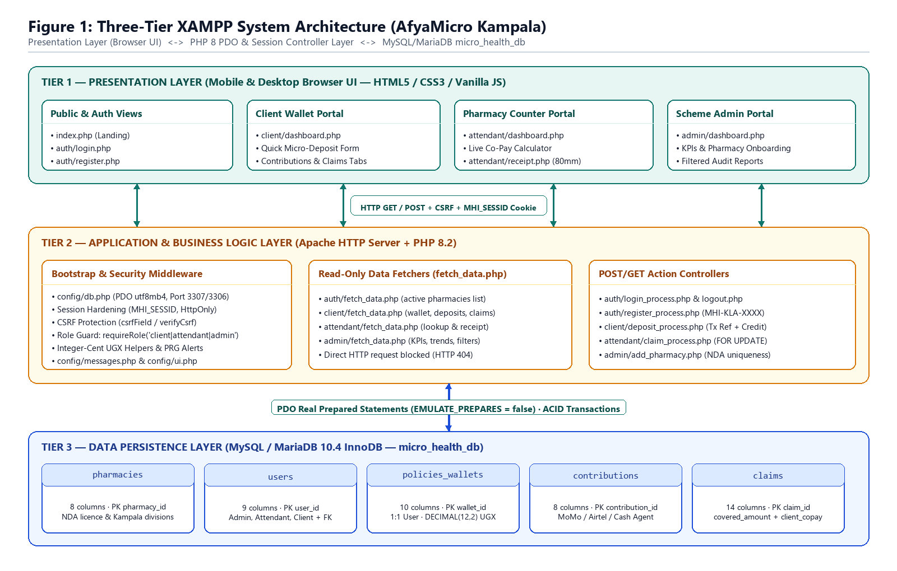

Every protected view (`client/dashboard.php`, `attendant/dashboard.php`, `attendant/receipt.php`, `admin/dashboard.php`) includes only its corresponding `fetch_data.php` script and `config/ui.php`, containing **zero inline SQL**. Mutations flow exclusively through `*_process.php` / `add_pharmacy.php` controllers using the **Post/Redirect/Get (PRG)** pattern.

## 4.4 System Interface Choice

A **responsive browser-based web interface** was selected over a native Android-only mobile app or a desktop-only ERP client because low-income Kampala clients interact primarily via Android mobile browsers while pharmacy attendants operate either desktop counter PCs or shared pharmacy tablets. One unified CSS3 stylesheet (`assets/css/style.css`) adapts automatically across `1360px` desktop grids, `760px` mobile drawers, and `80mm` thermal print media.

## 4.5 System Modeling

### 4.5.1 Context Diagram (Level-0 DFD)
The Context Diagram defines the boundary of AfyaMicro Kampala (`0.0`) and its information exchanges with the three external entities: **Low-Income Pharmacy Client (`E1`)**, **Pharmacy Attendant (`E2`)**, and **Scheme Administrator (`E3`)**.

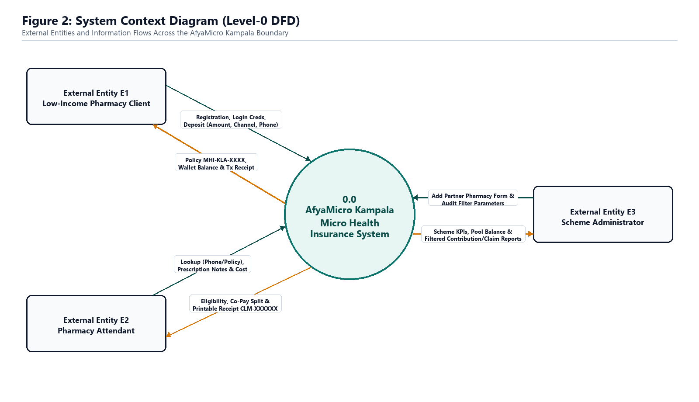

### 4.5.2 Level-1 Data Flow Diagram (DFD)
The Level-1 DFD decomposes process `0.0` into four core processes (`1.0 User & Policy Registration / Auth`, `2.0 Micro-Premium Deposit Processing`, `3.0 Eligibility Check & Claim Deduction`, and `4.0 Scheme Oversight & Audit Reporting`) interacting with five data stores (`D1 pharmacies`, `D2 users`, `D3 policies_wallets`, `D4 contributions`, `D5 claims`).

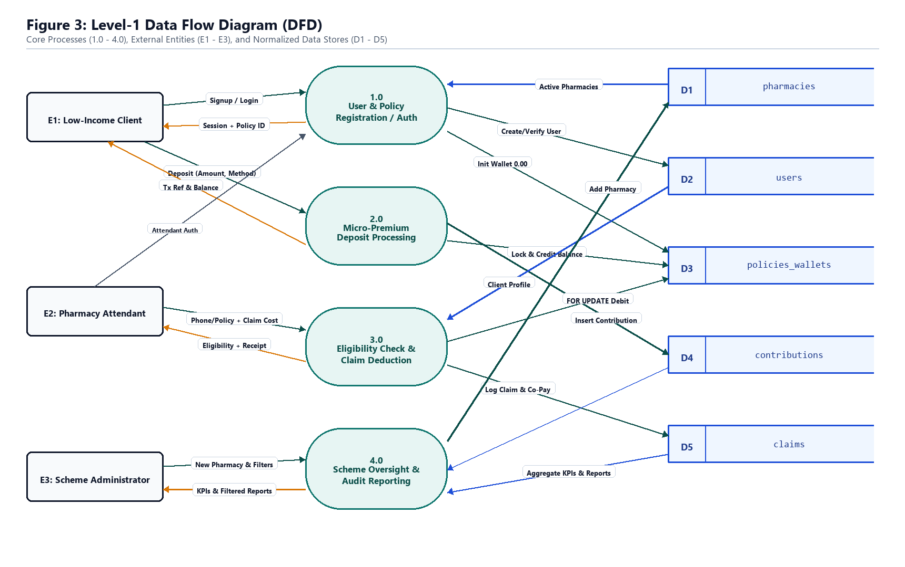

### 4.5.3 Use-Case Analyses
Eight core use cases (`UC-01` through `UC-08`) govern system interaction across the three actors, as shown in Figure 4 and summarized in Table 1.

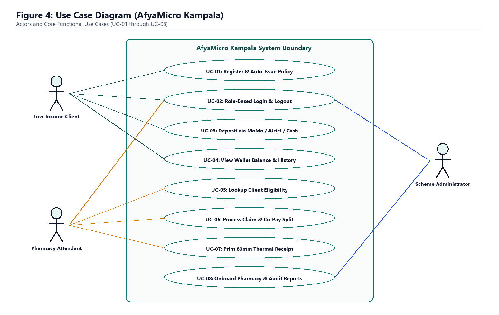

**Table 1: Use Case Specification Summary (`UC-01` to `UC-08`)**

| UC ID | Use Case Name | Primary Actor | Pre-Conditions | Main Flow Summary | Post-Conditions / Endpoint |
|---|---|---|---|---|---|
| **UC-01** | Client Registration & Auto-Wallet Issuance | Low-Income Client | Unauthenticated; ≥ 1 active pharmacy | Client submits `full_name`, `phone`, optional `nin`, `pharmacy_id`, and password; backend generates `MHI-KLA-XXXX` and inserts `users` + `policies_wallets` (`0.00` UGX) in one transaction. | Client auto-logged in → `client/dashboard.php?success=registered` (`auth/register_process.php`) |
| **UC-02** | Role-Based Login & Logout | Client, Attendant, Admin | Active user account | User submits `phone` & `password`; `password_verify()` validates hash; session ID regenerated and routed by `role`. Logout clears session & cookie. | Role dashboard loaded (`auth/login_process.php`, `auth/logout.php`) |
| **UC-03** | Micro-Premium Deposit | Low-Income Client | Authenticated `client`; active wallet | Client selects UGX amount, `payment_method` (`MTN_MoMo`, `Airtel_Money`, `Cash_Agent`), and optional `payer_phone`; wallet locked via `FOR UPDATE`, reference generated, balances incremented. | Credited → `client/dashboard.php?success=deposit_completed&ref=...` (`client/deposit_process.php`) |
| **UC-04** | Client Wallet & Ledger View | Low-Income Client | Authenticated `client` | `client/fetch_data.php` retrieves wallet totals, deposits, claims, and partner pharmacies. | Wallet card & tabbed histories rendered (`client/dashboard.php`) |
| **UC-05** | Attendant Client Lookup | Pharmacy Attendant | Authenticated `attendant` | Attendant enters phone or policy ID (`GET ?search=`); backend loads `$lookupClient`, `$canClaim`, and recent claims. | Eligibility panel & claim form displayed (`attendant/dashboard.php`) |
| **UC-06** | Prescription Claim & Co-Pay Split | Pharmacy Attendant | `$canClaim === true` | Attendant enters `prescription_notes` & `total_cost`; backend locks wallet (`FOR UPDATE`), rejects if balance `<= 0`, else deducts `covered_amount` and records `client_copay`. | Wallet debited → `attendant/receipt.php?claim_id=<id>` (`attendant/claim_process.php`) |
| **UC-07** | Printable Thermal Receipt | Pharmacy Attendant | Claim belongs to attendant's pharmacy | `attendant/fetch_data.php` loads itemized receipt (`CLM-XXXXXX`) scoped to `pharmacy_id`; attendant triggers `window.print()`. | Physical `80mm` / A4 copy issued (`attendant/receipt.php`) |
| **UC-08** | Pharmacy Onboarding & Audit Reports | Scheme Administrator | Authenticated `admin` | Admin views KPIs, adds new Kampala pharmacies (`add_pharmacy.php`), and filters contribution/claim reports (`GET`). | Pharmacy added (`?success=pharmacy_added`) or filtered report displayed (`admin/dashboard.php`) |

### 4.5.4 End-to-End Claim & Co-Pay Flowchart
Figure 6 illustrates the critical pharmacy counter claim decision logic enforcing atomic wallet locking and deterministic co-payment splitting.

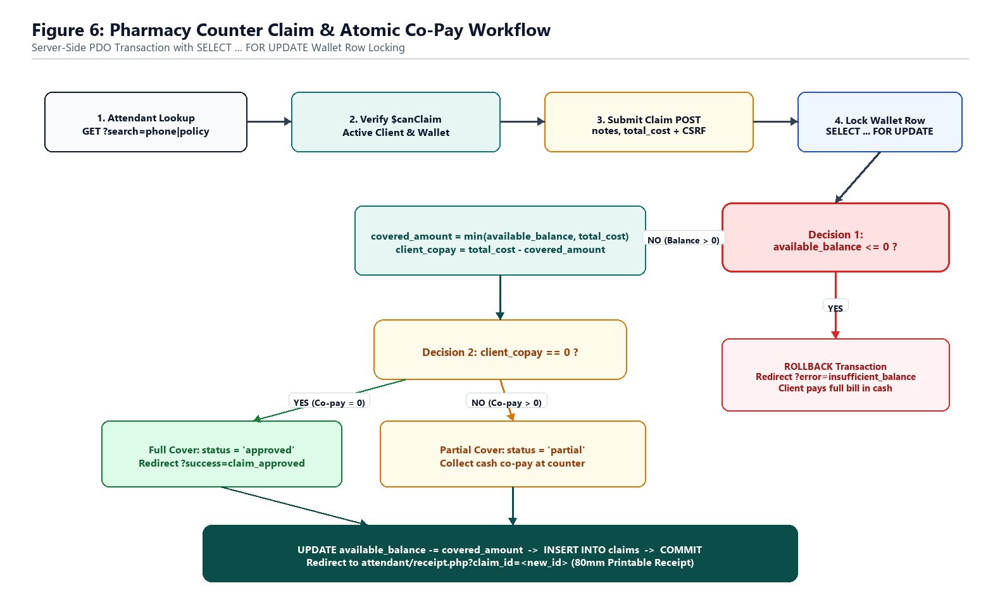

### 4.5.5 Entity-Relationship Diagram (ERD)
The relational database `micro_health_db` implements five normalized tables (3NF) linked by six foreign-key relationships:

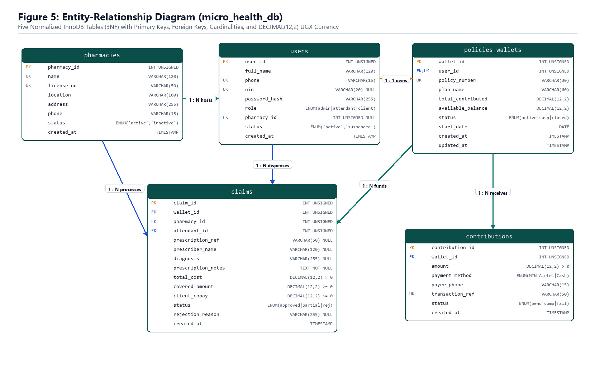

**Table 2: Cardinality & Referential Integrity Rules**

| Relationship | Cardinality | Foreign Key & Cascade Policy | Business Rule |
|---|---|---|---|
| `pharmacies` → `users` | `1 : N` | `fk_users_pharmacy` (`ON UPDATE CASCADE`, `ON DELETE SET NULL`) | Links attendants to workplace pharmacies and clients to home pharmacies; admins have `pharmacy_id = NULL`. |
| `users` → `policies_wallets` | `1 : 1` | `fk_wallets_user` + `uq_wallets_user` (`ON UPDATE CASCADE`, `ON DELETE RESTRICT`) | Guarantees exactly one savings-backed policy wallet per client (`UNIQUE user_id`). |
| `policies_wallets` → `contributions` | `1 : N` | `fk_contrib_wallet` (`ON UPDATE CASCADE`, `ON DELETE RESTRICT`) | Tracks all deposit attempts into a wallet; financial history cannot be orphaned. |
| `policies_wallets` → `claims` | `1 : N` | `fk_claims_wallet` (`ON UPDATE CASCADE`, `ON DELETE RESTRICT`) | Links every prescription claim back to the insured client wallet. |
| `pharmacies` → `claims` | `1 : N` | `fk_claims_pharmacy` (`ON UPDATE CASCADE`, `ON DELETE RESTRICT`) | Clients may claim at any active partner pharmacy; dispensing pharmacy comes from session. |
| `users` → `claims` | `1 : N` | `fk_claims_attendant` (`ON UPDATE CASCADE`, `ON DELETE RESTRICT`) | Audits the exact pharmacy attendant (`attendant_id`) who dispensed the claim. |

### 4.5.6 Database Schema Data Dictionary (`micro_health_db`)
All tables use the InnoDB engine (`utf8mb4_unicode_ci`, `+03:00` EAT) and store UGX amounts in `DECIMAL(12,2)`. Verified live on `127.0.0.1:3307` against `database/database.sql`.

**Table 3: Data Dictionary — `pharmacies`**

| Column Name | Data Type | Null / Default | Keys & Constraints | Purpose & Business Rules |
|---|---|---|---|---|
| `pharmacy_id` | `INT UNSIGNED` | `NOT NULL`, `AUTO_INCREMENT` | `PRIMARY KEY` | Unique surrogate identifier for each partner pharmacy. |
| `name` | `VARCHAR(120)` | `NOT NULL` | `UNIQUE KEY uq_pharmacies_name` | Registered pharmacy name (min 3 chars). |
| `license_no` | `VARCHAR(50)` | `NOT NULL` | `UNIQUE KEY uq_pharmacies_license` | Unique NDA licence number (stored uppercase). |
| `location` | `VARCHAR(100)` | `NOT NULL` | — | Kampala KCCA division or trading area. |
| `address` | `VARCHAR(255)` | `NULL` | — | Optional street/plot landmark. |
| `phone` | `VARCHAR(15)` | `NOT NULL` | — | 10-digit pharmacy telephone (`0414...` or `07...`). |
| `status` | `ENUM('active','inactive')` | `NOT NULL`, Default `'active'` | — | Controls registration & claim eligibility. |
| `created_at` | `TIMESTAMP` | `NOT NULL`, `CURRENT_TIMESTAMP` | — | Record creation timestamp. |

**Table 4: Data Dictionary — `users`**

| Column Name | Data Type | Null / Default | Keys & Constraints | Purpose & Business Rules |
|---|---|---|---|---|
| `user_id` | `INT UNSIGNED` | `NOT NULL`, `AUTO_INCREMENT` | `PRIMARY KEY` | Internal user ID stored in `$_SESSION['user_id']`. |
| `full_name` | `VARCHAR(120)` | `NOT NULL` | — | User full name (3–120 characters). |
| `phone` | `VARCHAR(15)` | `NOT NULL` | `UNIQUE KEY uq_users_phone` | Login identifier (`07XXXXXXXX`). |
| `nin` | `VARCHAR(20)` | `NULL` | `UNIQUE KEY uq_users_nin` | Optional 14-char Uganda National ID Number. |
| `password_hash` | `VARCHAR(255)` | `NOT NULL` | — | `bcrypt` hash via PHP `password_hash()`. |
| `role` | `ENUM('admin','attendant','client')` | `NOT NULL`, Default `'client'` | `KEY idx_users_role` | RBAC role governing portal access. |
| `pharmacy_id` | `INT UNSIGNED` | `NULL` | `FK fk_users_pharmacy`, `KEY idx_users_pharmacy` | Workplace/home pharmacy (`NULL` for admin). |
| `status` | `ENUM('active','suspended')` | `NOT NULL`, Default `'active'` | — | Account activation state. |
| `created_at` | `TIMESTAMP` | `NOT NULL`, `CURRENT_TIMESTAMP` | — | Registration timestamp. |

**Table 5: Data Dictionary — `policies_wallets`**

| Column Name | Data Type | Null / Default | Keys & Constraints | Purpose & Business Rules |
|---|---|---|---|---|
| `wallet_id` | `INT UNSIGNED` | `NOT NULL`, `AUTO_INCREMENT` | `PRIMARY KEY` | Unique surrogate key for client wallet. |
| `user_id` | `INT UNSIGNED` | `NOT NULL` | `UNIQUE uq_wallets_user`, `FK fk_wallets_user` | Owner client (`1:1` relation). |
| `policy_number` | `VARCHAR(30)` | `NOT NULL` | `UNIQUE uq_wallets_policy` | Unique policy ID (`MHI-KLA-XXXX`). |
| `plan_name` | `VARCHAR(60)` | `NOT NULL`, Default `'Basic Care Plan'` | — | Insurance benefit tier label. |
| `total_contributed` | `DECIMAL(12,2)` | `NOT NULL`, Default `0.00` | `CHECK (total_contributed >= 0)` | Lifetime sum of completed UGX deposits. |
| `available_balance` | `DECIMAL(12,2)` | `NOT NULL`, Default `0.00` | `CHECK (available_balance >= 0)` | Spendable UGX balance locked with `FOR UPDATE`. |
| `status` | `ENUM('active','suspended','closed')` | `NOT NULL`, Default `'active'` | — | Wallet eligibility status. |
| `start_date` | `DATE` | `NOT NULL` | — | Policy start date (`CURDATE()` on signup). |
| `created_at` | `TIMESTAMP` | `NOT NULL`, `CURRENT_TIMESTAMP` | — | Creation timestamp. |
| `updated_at` | `TIMESTAMP` | `NOT NULL`, `ON UPDATE CURRENT_TIMESTAMP` | — | Last balance/status update timestamp. |

**Table 6: Data Dictionary — `contributions`**

| Column Name | Data Type | Null / Default | Keys & Constraints | Purpose & Business Rules |
|---|---|---|---|---|
| `contribution_id` | `INT UNSIGNED` | `NOT NULL`, `AUTO_INCREMENT` | `PRIMARY KEY` | Surrogate deposit transaction ID. |
| `wallet_id` | `INT UNSIGNED` | `NOT NULL` | `KEY idx_contrib_wallet`, `FK fk_contrib_wallet` | Credited client wallet. |
| `amount` | `DECIMAL(12,2)` | `NOT NULL` | `CHECK (amount > 0)` | Deposit amount in UGX (`<= 5,000,000` in app). |
| `payment_method` | `ENUM('MTN_MoMo','Airtel_Money','Cash_Agent')` | `NOT NULL` | — | Selected mobile-money or agent channel. |
| `payer_phone` | `VARCHAR(15)` | `NOT NULL` | — | Charged mobile number (`07XXXXXXXX`). |
| `transaction_ref` | `VARCHAR(50)` | `NOT NULL` | `UNIQUE KEY uq_contrib_txref` | Generated ref (`MP...` / `AM...` / `CA...`). |
| `status` | `ENUM('pending','completed','failed')` | `NOT NULL`, Default `'completed'` | — | Settlement state (only `completed` credits wallet). |
| `created_at` | `TIMESTAMP` | `NOT NULL`, `CURRENT_TIMESTAMP` | `KEY idx_contrib_created` | Deposit timestamp. |

**Table 7: Data Dictionary — `claims`**

| Column Name | Data Type | Null / Default | Keys & Constraints | Purpose & Business Rules |
|---|---|---|---|---|
| `claim_id` | `INT UNSIGNED` | `NOT NULL`, `AUTO_INCREMENT` | `PRIMARY KEY` | Surrogate claim ID (`CLM-XXXXXX` on receipt). |
| `wallet_id` | `INT UNSIGNED` | `NOT NULL` | `KEY idx_claims_wallet`, `FK fk_claims_wallet` | Debited client wallet. |
| `pharmacy_id` | `INT UNSIGNED` | `NOT NULL` | `KEY idx_claims_pharmacy`, `FK fk_claims_pharmacy` | Dispensing pharmacy (`$_SESSION['pharmacy_id']`). |
| `attendant_id` | `INT UNSIGNED` | `NOT NULL` | `KEY idx_claims_attendant`, `FK fk_claims_attendant` | Processing attendant (`$_SESSION['user_id']`). |
| `prescription_ref` | `VARCHAR(50)` | `NULL` | — | Optional clinic Rx reference. |
| `prescriber_name` | `VARCHAR(120)` | `NULL` | — | Optional prescriber / clinic name. |
| `diagnosis` | `VARCHAR(255)` | `NULL` | — | Optional clinical indication. |
| `prescription_notes` | `TEXT` | `NOT NULL` | — | Dispensed medicines & quantities (min 3 chars). |
| `total_cost` | `DECIMAL(12,2)` | `NOT NULL` | `CHECK (total_cost > 0)` | Full prescription bill in UGX. |
| `covered_amount` | `DECIMAL(12,2)` | `NOT NULL`, Default `0.00` | `CHECK (covered_amount >= 0)` | Deducted wallet portion (`min(balance, total_cost)`). |
| `client_copay` | `DECIMAL(12,2)` | `NOT NULL`, Default `0.00` | `CHECK (client_copay >= 0)` & `CHECK (covered_amount + client_copay = total_cost)` | Cash balance collected from client at counter. |
| `status` | `ENUM('approved','partial','rejected')` | `NOT NULL`, Default `'approved'` | — | `approved` if co-pay is 0; `partial` if co-pay > 0. |
| `rejection_reason` | `VARCHAR(255)` | `NULL` | — | Optional rejection note. |
| `created_at` | `TIMESTAMP` | `NOT NULL`, `CURRENT_TIMESTAMP` | `KEY idx_claims_created` | Claim timestamp. |

---

# CHAPTER FIVE: SYSTEMS DEVELOPMENT AND PRESENTATION

## 5.0 Introduction

This chapter describes how the logical design in Chapter Four was engineered into a working XAMPP application and presents the implemented modules via live system screenshots and core backend code.

## 5.1 Systems Development

The application was structured into modular directories (`config/`, `database/`, `auth/`, `client/`, `attendant/`, `admin/`, `assets/css/`, `assets/js/`, `docs/`). Core shared behavior resides in `config/db.php` (PDO connection to `127.0.0.1:3307`/`3306` with `utf8mb4` and `ERRMODE_EXCEPTION`, hardened `MHI_SESSID` session configuration, `requireRole()`, CSRF generation/validation, `+256` phone normalization, and integer-cent UGX parsing), `config/messages.php` (mapping URL `?success=` and `?error=` codes via `statusMessage()`), and `config/ui.php` (SVG icon library and `uiPortalStart()`/`uiPortalEnd()` layout shell).

All visual styling—originally prototyped in Figma Make—was compiled into a single dependency-free CSS3 stylesheet (`assets/css/style.css`) implementing the `#0F766E` teal and `#F59E0B` amber theme, Plus Jakarta Sans typography, mobile drawer navigation, and `80mm` `@media print` receipt formatting. All dynamic client-side interactions (deposit UGX preset pills, live co-pay breakdown calculation, tabs, password toggles, collapsible forms, and print triggers) were implemented in pure Vanilla JavaScript (`assets/js/app.js`).

## 5.2 Systems Presentation

### 5.2.1 Module 1: Public Landing Page & Authentication (`index.php`, `auth/login.php`, `auth/register.php`)
The public landing page presents the AfyaMicro value proposition, a live-styled health wallet card preview, a three-step onboarding guide, and Kampala's three verified launch pharmacies (Kisenyi Care Pharmacy, Kawempe Community Chemist, and Katwe Hope Pharmacy), linking cleanly to Login and Client Registration.

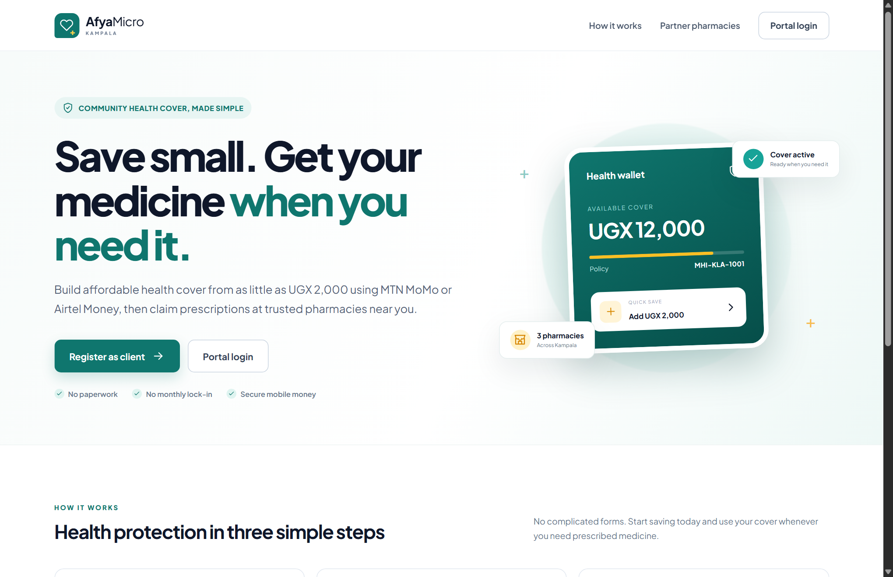

### 5.2.2 Module 2: Client Health Wallet & Mobile-Money Micro-Deposits (`client/dashboard.php`)
Authenticated clients access their real-time Health Wallet card displaying `available_balance`, `total_contributed`, total covered claims, and policy ID badge (`MHI-KLA-2026-00001`). Clients top up via the Quick Micro-Deposit form using preset UGX pills (`UGX 2,000`–`UGX 20,000`) and select `MTN MoMo`, `Airtel Money`, or `Cash Agent`. Submissions invoke `client/deposit_process.php`, which locks the wallet row via `FOR UPDATE`, creates a unique reference, and updates both `total_contributed` and `available_balance` atomically.

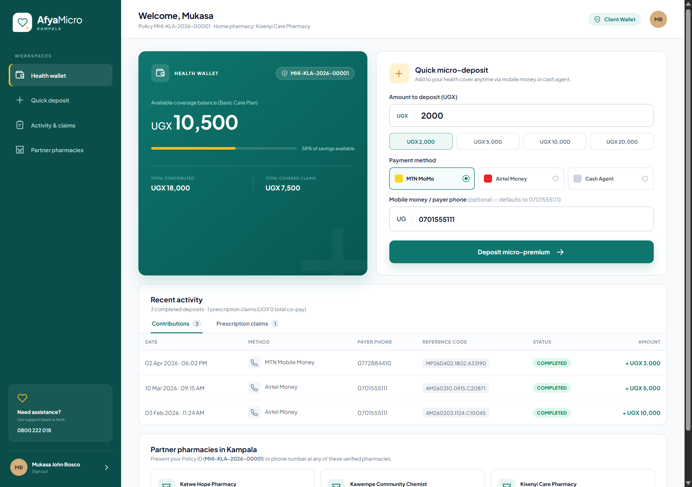

### 5.2.3 Module 3: Pharmacy Attendant Counter Lookup & Live Co-Pay Checkout (`attendant/dashboard.php`)
At the pharmacy counter, attendants look up clients by phone number (`0701555111`) or policy ID (`MHI-KLA-2026-00002`). Once verified, attendants enter `prescription_notes` and `total_cost`. As demonstrated in Figure 9, Vanilla JS dynamically previews the co-payment split (for example, on Namuli Grace's UGX 15,000 balance against a UGX 22,000 bill, Insurance Covers `UGX 15,000` and Client Cash Co-Pay `UGX 7,000`) before `attendant/claim_process.php` enforces the exact calculation server-side inside a locked PDO transaction.

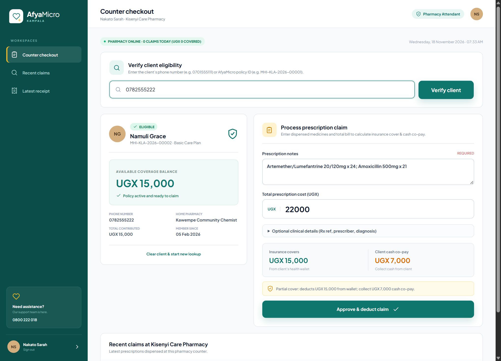

### 5.2.4 Module 4: Printable Thermal Claim Receipt (`attendant/receipt.php`)
Immediately after claim approval (`approved` or `partial`), the controller redirects to `attendant/receipt.php?claim_id=<id>`, rendering an `80mm`-compatible receipt (`CLM-000001`) showing pharmacy NDA licence, attendant name, client details, medication notes, itemized cost/co-pay split, remaining wallet balance, and a one-click Print Receipt button (`window.print()`).

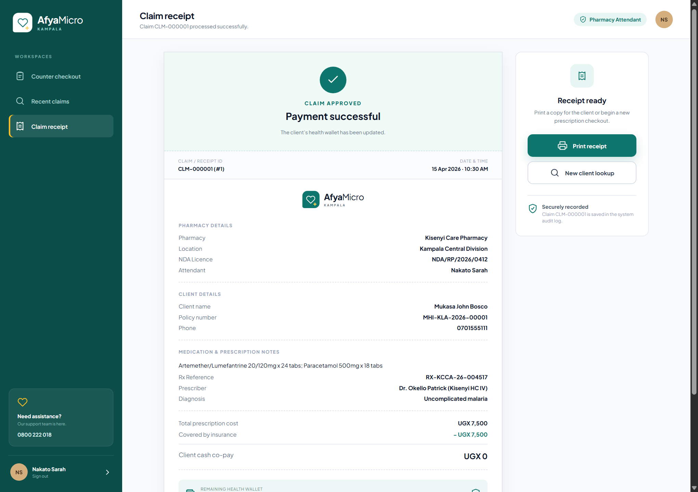

### 5.2.5 Module 5: Scheme Administrator KPIs, Pharmacies & Audit Reports (`admin/dashboard.php`)
The Scheme Administrator dashboard aggregates live scheme KPIs (Total Pool Funds, Active Clients, Partner Pharmacies, and Total Claims Paid), enables onboarding new NDA-licensed pharmacies (`admin/add_pharmacy.php`), and provides multi-filter audit tables across Contributions, Claims, Payment Channels, 6-Month Trends, and Registered Clients.

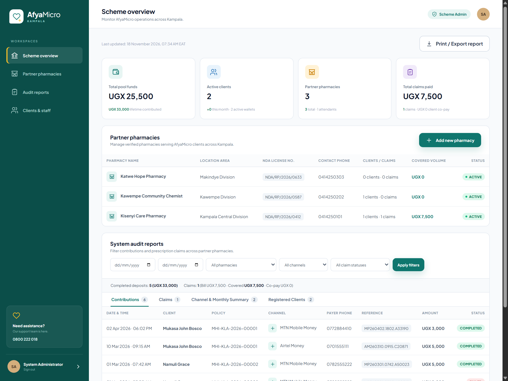

### 5.2.6 Sample Core Backend Code (Atomic Claim Deduction — `attendant/claim_process.php`)
```php
$pdo->beginTransaction();
$stmt = $pdo->prepare(
    "SELECT w.wallet_id, w.available_balance, w.status AS wallet_status, u.status AS user_status
       FROM policies_wallets w
       JOIN users u ON u.user_id = w.user_id
      WHERE w.user_id = :client_id AND u.role = 'client'
      LIMIT 1 FOR UPDATE"
);
$stmt->execute([':client_id' => $clientId]);
$wallet = $stmt->fetch();

$balanceCents = parseAmountToCents((string) $wallet['available_balance']) ?? 0;
if ($balanceCents <= 0) {
    $pdo->rollBack();
    $fail('insufficient_balance');
}

$coveredCents = min($balanceCents, $totalCents);
$copayCents   = $totalCents - $coveredCents;
$status       = $copayCents === 0 ? 'approved' : 'partial';
```

---

# CHAPTER SIX: EVALUATION, VALIDATION AND RECOMMENDATIONS

## 6.0 Introduction

This chapter presents empirical validation test results verifying Objective (iv), critically evaluates the completed artifact, states key recommendations and study limitations, and proposes areas for further research.

## 6.1 System Validation and Testing Results

To validate functionality, security, and reliability against Objective (iv), two automated integration suites were executed against a live PHP 8.2 server and MariaDB 10.4.32 (`127.0.0.1:3307`): a 52-case backend controller test suite and a 24-case end-to-end HTTP UI verification suite. **All 52 backend tests and 24 UI tests passed (100% pass rate).**

**Table 8: Summary of System Validation Test Cases**

| Test ID | Test Case & Module | Input / Scenario Executed | Expected System Outcome | Observed Result | Status |
|---|---|---|---|---|---|
| **TC-01** | Client Registration (`auth/register_process.php`) | Valid client signup (`0755123456`, Katwe pharmacy) | Create `users` + `policies_wallets` (`0.00` UGX, `MHI-KLA-XXXX`), auto-login | Redirected to `client/dashboard.php?success=registered`, `MHI-KLA-XXXX` generated | **PASS** |
| **TC-02** | Duplicate Phone Guard (`auth/register_process.php`) | Signup using existing phone `0701555111` | Reject duplicate without creating orphan wallet | Redirected to `register.php?error=phone_taken` | **PASS** |
| **TC-03** | Role-Based Login & Phone Normalization | Login as `0701555111` & `+256 701 555 111` | Verify bcrypt hash, normalize `+256`, route to `client/dashboard.php` | Session established (`MHI_SESSID`), routed with `?success=welcome` | **PASS** |
| **TC-04** | Client Micro-Deposit (`client/deposit_process.php`) | Deposit `UGX 2,000` via `MTN_MoMo` / `Airtel_Money` / `Cash_Agent` | Generate unique ref (`MP`/`AM`/`CA`), credit `total_contributed` & `available_balance` | Balance rose `10,500` → `12,500`, `total_contributed` `18,000` → `20,000` | **PASS** |
| **TC-05** | Invalid Deposit Rejection | Submit `amount = 0` or invalid channel | Reject before DB mutation, return to deposit view | Redirected to `client/deposit.php?error=invalid_amount` with alert | **PASS** |
| **TC-06** | Attendant Client Lookup (`attendant/dashboard.php`) | Search by `0782555222` & `mhi-kla-2026-00001` | Return active client profile, balance, and `$canClaim = true` | Displayed Namuli Grace (`UGX 15,000`) & Mukasa (`UGX 10,500`) | **PASS** |
| **TC-07** | Fully Covered Prescription Claim | Cost `UGX 5,000` on `UGX 15,000` balance | `covered = 5,000`, `copay = 0`, `status = 'approved'`, balance `10,000` | Redirected to `receipt.php?claim_id=...&success=claim_approved` | **PASS** |
| **TC-08** | Partial Cover & Co-Pay Claim | Cost `UGX 25,500` on remaining `UGX 10,000` balance | `covered = 10,000`, `copay = 15,500`, `status = 'partial'`, balance `0` | Receipt displayed `PARTIAL COVERAGE`, `UGX 15,500` co-pay due | **PASS** |
| **TC-09** | Zero-Balance Claim Rejection | Submit `UGX 1,000` claim when balance `= 0` | Rollback transaction, reject with `insufficient_balance` | Redirected to `lookup.php?search=0782555222&error=insufficient_balance` | **PASS** |
| **TC-10** | Receipt Access Isolation | Request non-existent or cross-pharmacy `claim_id` | Block viewing other pharmacies' receipts | Returned `claim_not_found` alert safely | **PASS** |
| **TC-11** | Admin Add Pharmacy & Report Filters | Add `Rubaga Sunrise Pharmacy`; filter `claim_status=partial` | Persist pharmacy (`?success=pharmacy_added`); filter audit tables | Pharmacy listed; partial claim report matched `1` record | **PASS** |
| **TC-12** | RBAC, Direct Fetcher & CSRF Security | Client accesses attendant data; forged CSRF; direct `fetch_data.php` | Enforce `access_denied`, `session_expired`, and HTTP `404` | All unauthorized requests blocked cleanly | **PASS** |

## 6.2 Critical System Evaluation

Evaluated across an Input–Process–Output framework, AfyaMicro Kampala accepts structured browser inputs sanitized at the PHP boundary (`normalizePhone()`, `parseAmountToCents()`, `inputText()`), processes financial state transitions inside `FOR UPDATE` InnoDB transactions using exact `DECIMAL(12,2)` precision, and outputs actionable dashboards, printable `80mm` thermal receipts, and filtered multi-pharmacy audit summaries. Every specific objective established in Chapter One was demonstrably achieved within the completed codebase.

## 6.3 Recommendations

1. **For Kampala Community Pharmacies:** Adopt AfyaMicro's counter lookup and `80mm` receipt workflow to formalize micro-savings redemption and eliminate manual paper credit reconciliation errors.
2. **For Scheme Operators:** Enforce regular weekly administrative reviews of `admin/dashboard.php` pool balances versus pharmacy payouts and maintain accurate NDA licence records during pharmacy onboarding.
3. **For Regulators and Health Financing Partners (MoH, UCC, NDA):** Support sandbox interoperability between licensed retail pharmacies and mobile-money aggregators to lower transaction costs on micro-deposits (`UGX 1,000`–`UGX 5,000`).

## 6.4 Limitations of the Study

1. **Simulated Mobile-Money Gateway:** Deposits (`MTN_MoMo`, `Airtel_Money`, `Cash_Agent`) were processed through a controlled simulation that immediately settles completed contributions rather than invoking live MTN/Airtel USSD push APIs, which require commercial merchant credentials and regulatory clearance.
2. **Simulated Field Dataset:** Prototype validation relied on representative Kampala seed accounts and synthesized test transactions rather than live patient prescription volumes due to time and clinical privacy constraints.
3. **Connectivity Dependency:** Because the system runs as a browser-based web application on Apache/MySQL, client and counter transactions require local network or mobile internet availability.

## 6.5 Areas of Further Research

1. Integrating production MTN MoMo Collections and Airtel Money Open APIs with asynchronous webhook verification (`pending` → `completed`).
2. Extending client accessibility with a complementary USSD menu gateway (`*XXX#`) for feature-phone users lacking smartphone browsers.
3. Integrating National Drug Authority (NDA) drug-catalog pricing APIs and pharmacy inventory synchronization to standardize prescription cost estimation.

---

# REFERENCES

GSMA. (2023). *The mobile economy Sub-Saharan Africa 2023*. London: GSMA.

Hevner, A. R., March, S. T., Park, J., & Ram, S. (2004). Design science in information systems research. *MIS Quarterly*, 28(1), 75–105.

International Labour Organization. (2021). *Extending social health protection: Accelerating progress towards universal health coverage in Asia and the Pacific*. Geneva: International Labour Office.

Ministry of Health Uganda. (2020). *National eHealth strategy 2020/2021–2024/2025*. Kampala: Ministry of Health, Republic of Uganda.

Uganda Communications Commission. (2025). *Market performance report Q3 2025*. Kampala: Uganda Communications Commission.

World Bank. (2022). *The Global Findex Database 2021: Financial inclusion, digital payments, and resilience in the age of COVID-19*. Washington, DC: World Bank Group.

World Health Organization. (2020). *Digital implementation investment guide (DIIG): Integrating digital interventions into health programmes*. Geneva: World Health Organization.

World Health Organization. (2021). *Global strategy on digital health 2020–2025*. Geneva: World Health Organization.

---

# APPENDICES

## Appendix I: Interview Guide for Pharmacy Owners and Attendants
1. How do you currently handle low-income clients who cannot afford to pay for full prescriptions at once?
2. Would a web-based micro health insurance application improve service delivery and record reconciliation in your pharmacy?
3. What essential client information (phone number, policy ID, NIN) should be captured during registration and verified at the counter?
4. What operational challenges (connectivity, device availability, receipt printing, staff training) might arise when deploying this system at your counter?

## Appendix II: Interview Guide for Pharmacy Clients
1. How frequently do you visit community pharmacies in your area, and what challenges do you face when paying for prescribed medicines?
2. Which mobile money channel (MTN MoMo, Airtel Money, or Cash Agent) do you use most often, and how much could you comfortably save per deposit?
3. What information would you want to see on your health wallet dashboard and pharmacy receipt to trust the system?

## Appendix III: Project Implementation Schedule

| Period | Key Project Activity | Deliverable Produced |
|---|---|---|
| Weeks 1–2 | Proposal writing, literature review & requirements gathering | Approved Proposal (`ITPD_Proposal.docx`) |
| Week 3 | System analysis, modeling & relational database design | ERD, DFDs, `database/database.sql`, `BACKEND_CONTRACT.md` |
| Weeks 4–6 | Prototype development (PHP 8 PDO backend + AfyaMicro CSS3/JS UI) | Full-stack application (`auth/`, `client/`, `attendant/`, `admin/`) |
| Week 7 | Automated backend/UI testing, bug fixes & validation | 52 backend checks & 24 E2E UI checks passing |
| Week 8 | Final project report compilation & presentation preparation | `FINAL_PROJECT_REPORT.docx` & GitHub `main` submission |

## Appendix IV: Project Research Budget

| Item / Resource Category | Specification | Estimated Cost (UGX) |
|---|---|---|
| Internet Data & Cloud Research Access | 8 weeks research, documentation & package downloads | 120,000 |
| Local Transport (Kampala Field Visits) | Pharmacy visits across Kisenyi, Kawempe & Katwe | 150,000 |
| Stationery, Printing & Binding | Interview guides, draft reviews & 1 hardcopy report binding | 95,000 |
| Software & Hosting Environment | Open-source XAMPP, PHP 8.2, MariaDB 10.4, Chrome, Git | 0 |
| Contingency (Miscellaneous) | Airtime & emergency printing | 45,000 |
| **Total Estimated Project Cost** | | **UGX 410,000** |

## Appendix V: Backend Endpoint Contract & Live Schema Verification Summary

- **Auth Endpoints:** `POST auth/login_process.php` (`phone`, `password`, `csrf_token`), `POST auth/register_process.php` (`full_name`, `phone`, `nin`, `pharmacy_id`, `password`, `confirm_password`, `csrf_token`), `GET auth/logout.php`.
- **Client Endpoints:** `client/dashboard.php` (`client/fetch_data.php`), `POST client/deposit_process.php` (`amount`, `payment_method`, `payer_phone`, `csrf_token`).
- **Attendant Endpoints:** `GET attendant/dashboard.php?search=` (`attendant/fetch_data.php`), `POST attendant/claim_process.php` (`client_id`, `prescription_notes`, `total_cost`, `prescription_ref`, `prescriber_name`, `diagnosis`, `csrf_token`), `GET attendant/receipt.php?claim_id=`.
- **Admin Endpoints:** `GET admin/dashboard.php` (`admin/fetch_data.php`), `POST admin/add_pharmacy.php` (`pharmacy_name`, `location_area`, `license_no`, `contact_phone`, `address`, `csrf_token`).
- **Database Verification (`127.0.0.1:3307`, `micro_health_db`):** Live MariaDB 10.4.32 `DESCRIBE` inspection confirmed exact schema parity with `database/database.sql` across all 5 tables (`pharmacies`: 3 seeded rows; `users`: 4 seeded rows; `policies_wallets`: 2 seeded rows; `contributions`: 6 seeded rows; `claims`: 1 seeded row).
