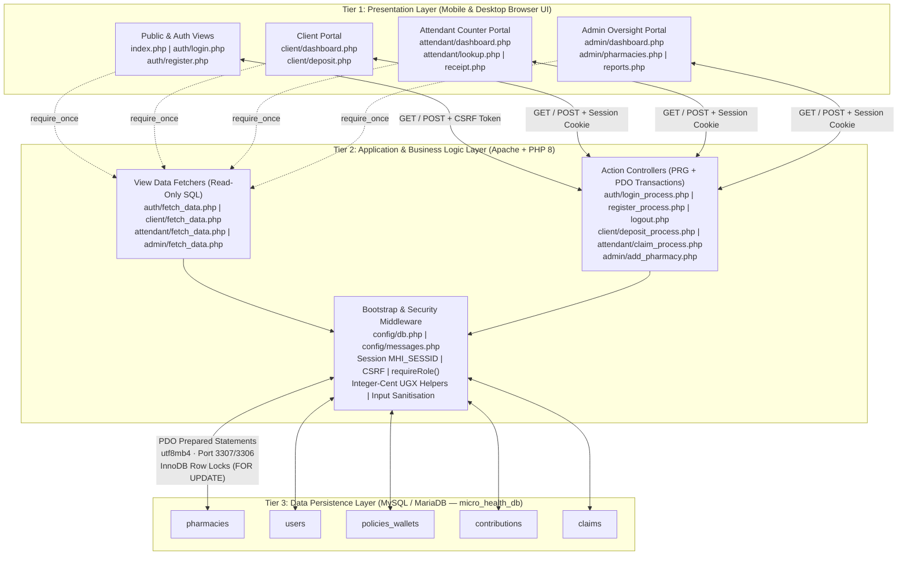
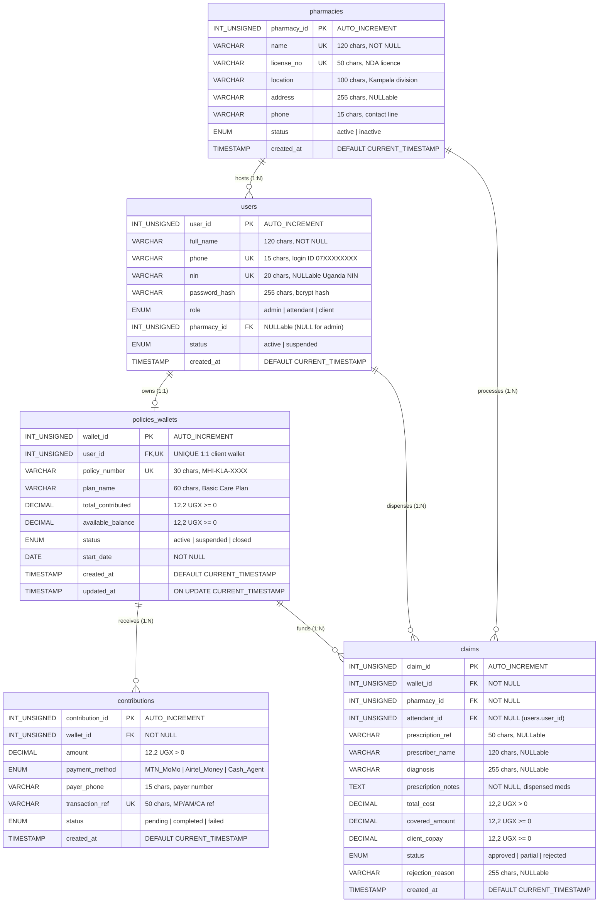
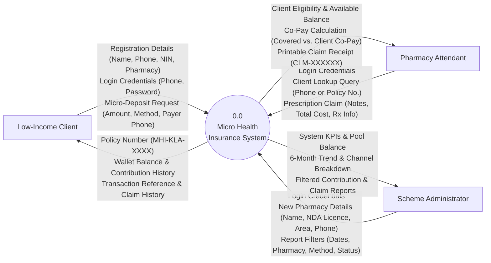
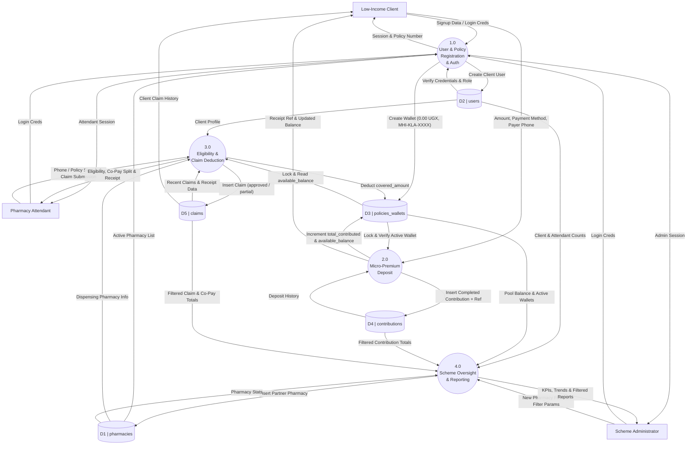
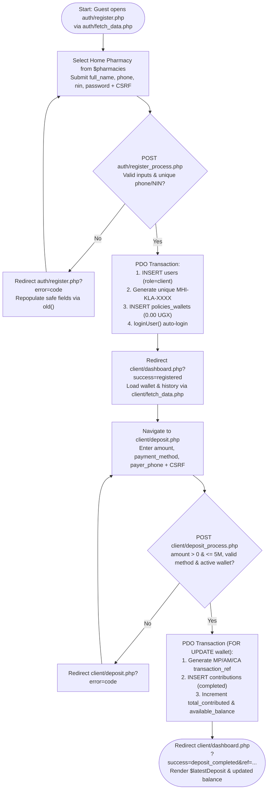
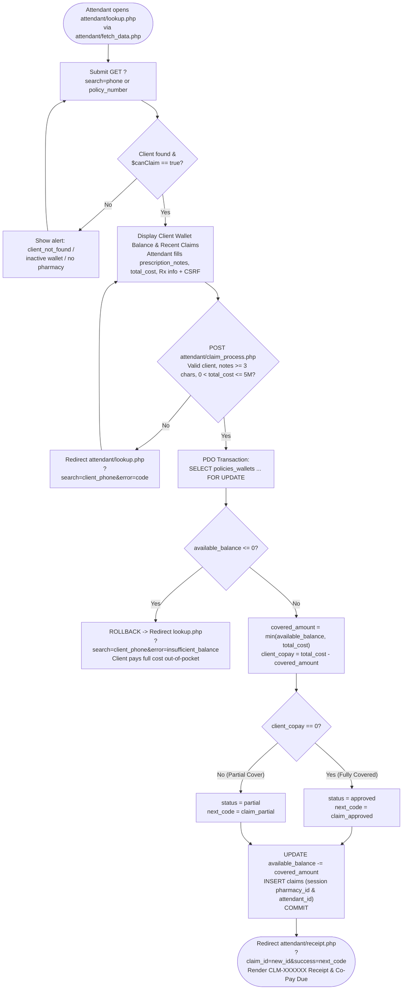
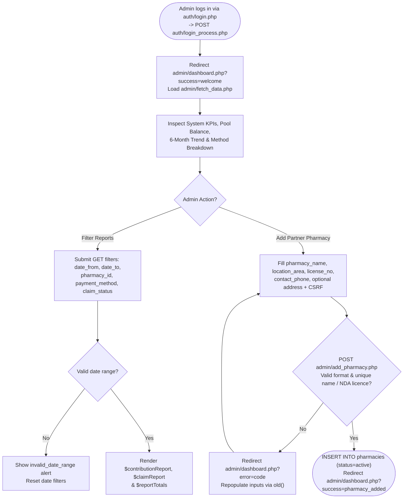

# System Analysis & Design Specification (Section 3.6)

**Project:** Web-Based Micro Health Insurance System for Low-Income Pharmacy Clients in Kampala, Uganda  
**Prepared for:** Makerere University Business School (MUBS) — Chapter 3 System Analysis & Design  
**Runtime Stack:** Apache HTTP Server (XAMPP) · PHP 8 (PDO) · MySQL / MariaDB (`micro_health_db`) · HTML5 · CSS3 · Vanilla JS  
**Reference Artifacts:** [database/database.sql](../database/database.sql) · [BACKEND_CONTRACT.md](../BACKEND_CONTRACT.md)

---

## 1. System Architecture (3-Tier XAMPP Architecture)

The application follows a **3-Tier Client–Server Web Architecture** hosted on XAMPP. Separating presentation templates, PHP 8 session/controller logic, and relational InnoDB storage ensures low bandwidth overhead on mobile/desktop pharmacy terminals while keeping all financial mutations atomic and strictly server-validated.

### Architectural Characteristics
1. **Strict Separation of Reads and Writes:** Every view includes its role-scoped `fetch_data.php` to populate PHP arrays without embedding SQL in HTML templates. Direct browser requests to `fetch_data.php` return HTTP `404`. All mutations go through dedicated `*_process.php` / `add_pharmacy.php` controllers using the **Post/Redirect/Get (PRG)** pattern with `?success=` / `?error=` status codes mapped via `config/messages.php`.
2. **Security & Financial Integrity Controls:**
   - Passwords hashed with PHP `password_hash(..., PASSWORD_DEFAULT)` (`bcrypt`) and verified with `password_verify()` (with dummy-hash timing uniformity and automatic `password_needs_rehash()` upgrades).
   - Sessions use `MHI_SESSID` with `HttpOnly`, `SameSite=Lax`, `use_strict_mode=1`, and `session_regenerate_id(true)` on login/registration.
   - Every `POST` form requires a session-bound `csrf_token` validated via `hash_equals()`.
   - Prepared statements run with `PDO::ATTR_EMULATE_PREPARES => false`. All UGX calculations are performed in integer cents (`parseAmountToCents()` / `centsToDecimal()`) inside ACID transactions, with `SELECT ... FOR UPDATE` locks preventing concurrent deposit/claim race conditions.
   - Server-side session attributes (`user_id`, `role`, `pharmacy_id`) are never accepted from form inputs during claims or deposits.

---

## 2. Entity-Relationship Diagram (ERD)

The relational schema in `micro_health_db` consists of **5 normalized tables (3NF)** using the InnoDB storage engine (`utf8mb4_unicode_ci`).

### Cardinality & Referential Integrity Rules
| Relationship | Cardinality | Foreign Key & Cascade Policy | Business Rule |
|---|---|---|---|
| `pharmacies` → `users` | `1 : N` (Optional) | `fk_users_pharmacy` (`ON UPDATE CASCADE`, `ON DELETE SET NULL`) | Attendants link to their workplace pharmacy; clients link to their preferred home pharmacy; system administrators store `pharmacy_id = NULL`. |
| `users` → `policies_wallets` | `1 : 1` (Optional for staff) | `fk_wallets_user` + `uq_wallets_user` (`ON UPDATE CASCADE`, `ON DELETE RESTRICT`) | Each insured `client` owns exactly one savings-backed policy wallet (`UNIQUE user_id`). Administrators and attendants have zero wallet rows. |
| `policies_wallets` → `contributions` | `1 : N` | `fk_contrib_wallet` (`ON UPDATE CASCADE`, `ON DELETE RESTRICT`) | A client wallet accumulates multiple mobile-money or cash-agent deposits over time; wallets with financial history cannot be deleted. |
| `policies_wallets` → `claims` | `1 : N` | `fk_claims_wallet` (`ON UPDATE CASCADE`, `ON DELETE RESTRICT`) | A client wallet funds multiple pharmacy prescription claims across time. |
| `pharmacies` → `claims` | `1 : N` | `fk_claims_pharmacy` (`ON UPDATE CASCADE`, `ON DELETE RESTRICT`) | Clients can redeem cover at any active partner pharmacy; every claim logs the dispensing pharmacy from the attendant's session. |
| `users` → `claims` | `1 : N` | `fk_claims_attendant` (`ON UPDATE CASCADE`, `ON DELETE RESTRICT`) | Every claim records the exact pharmacy attendant (`attendant_id`) who verified and dispensed the prescription. |

---

## 3. Database Schema Data Dictionary

Database: **`micro_health_db`** · Character Set: **`utf8mb4`** · Collation: **`utf8mb4_unicode_ci`** · Timezone: **`+03:00` (EAT)**  
All monetary fields use **`DECIMAL(12,2)`** in Ugandan Shillings (UGX) to guarantee exact fixed-point arithmetic without floating-point drift.

### Table 1: `pharmacies`
*Stores accredited partner pharmacies across Kampala divisions where clients register and redeem prescription cover.*

| Column Name | Data Type | Null / Default | Keys & Constraints | Purpose & Business Rules |
|---|---|---|---|---|
| `pharmacy_id` | `INT UNSIGNED` | `NOT NULL`, `AUTO_INCREMENT` | `PRIMARY KEY` | Unique surrogate identifier for each partner pharmacy. |
| `name` | `VARCHAR(120)` | `NOT NULL` | `UNIQUE KEY uq_pharmacies_name` | Registered trading name (e.g., *Kisenyi Care Pharmacy*). Min 3 chars enforced at application layer. |
| `license_no` | `VARCHAR(50)` | `NOT NULL` | `UNIQUE KEY uq_pharmacies_license` | National Drug Authority (NDA) operating licence number (stored uppercase, e.g., `NDA/RP/2026/0412`). |
| `location` | `VARCHAR(100)` | `NOT NULL` | — | Kampala KCCA division or trading area (e.g., *Kampala Central Division*, *Kawempe Division*). |
| `address` | `VARCHAR(255)` | `NULL` | — | Optional physical plot/street landmark for client navigation. |
| `phone` | `VARCHAR(15)` | `NOT NULL` | — | 10-digit pharmacy contact line (`0414...` landline or `07...` mobile). |
| `status` | `ENUM('active','inactive')` | `NOT NULL`, Default `'active'` | — | Controls whether the pharmacy appears in registration dropdowns and participates in claims. |
| `created_at` | `TIMESTAMP` | `NOT NULL`, Default `CURRENT_TIMESTAMP` | — | Audit timestamp when the pharmacy was onboarded. |

### Table 2: `users`
*Stores all system actors (scheme administrators, pharmacy attendants, and low-income clients) under a unified role-based authentication table.*

| Column Name | Data Type | Null / Default | Keys & Constraints | Purpose & Business Rules |
|---|---|---|---|---|
| `user_id` | `INT UNSIGNED` | `NOT NULL`, `AUTO_INCREMENT` | `PRIMARY KEY` | Unique internal user identifier stored in `$_SESSION['user_id']`. |
| `full_name` | `VARCHAR(120)` | `NOT NULL` | — | User's full legal name (3–120 characters). |
| `phone` | `VARCHAR(15)` | `NOT NULL` | `UNIQUE KEY uq_users_phone` | Primary login credential in Ugandan `07XXXXXXXX` format (`+256` normalized on input). |
| `nin` | `VARCHAR(20)` | `NULL` | `UNIQUE KEY uq_users_nin` | Optional 14-character Uganda National Identification Number (normalized to uppercase). |
| `password_hash` | `VARCHAR(255)` | `NOT NULL` | — | Salted `bcrypt` hash generated via PHP `password_hash()`. |
| `role` | `ENUM('admin','attendant','client')` | `NOT NULL`, Default `'client'` | `KEY idx_users_role` | RBAC role governing dashboard routing and access control (`requireRole()`). |
| `pharmacy_id` | `INT UNSIGNED` | `NULL` | `FK fk_users_pharmacy` → `pharmacies(pharmacy_id)`, `KEY idx_users_pharmacy` | Attendant's assigned dispensing pharmacy or client's chosen home pharmacy (`NULL` for admins). |
| `status` | `ENUM('active','suspended')` | `NOT NULL`, Default `'active'` | — | Account state; suspended users are blocked at login and claim lookup. |
| `created_at` | `TIMESTAMP` | `NOT NULL`, Default `CURRENT_TIMESTAMP` | — | Registration timestamp (used in monthly client growth KPIs). |

### Table 3: `policies_wallets`
*Holds the micro-insurance policy metadata and real-time UGX savings wallet balance for each client (strictly 1:1 with client `users`).*

| Column Name | Data Type | Null / Default | Keys & Constraints | Purpose & Business Rules |
|---|---|---|---|---|
| `wallet_id` | `INT UNSIGNED` | `NOT NULL`, `AUTO_INCREMENT` | `PRIMARY KEY` | Unique surrogate key referenced by `contributions` and `claims`. |
| `user_id` | `INT UNSIGNED` | `NOT NULL` | `UNIQUE KEY uq_wallets_user`, `FK fk_wallets_user` → `users(user_id)` | Owner client; uniqueness guarantees one policy wallet per client. |
| `policy_number` | `VARCHAR(30)` | `NOT NULL` | `UNIQUE KEY uq_wallets_policy` | Human-readable policy ID (`MHI-KLA-XXXX` on new registrations; seeded as `MHI-KLA-2026-00001`). Used for attendant lookup. |
| `plan_name` | `VARCHAR(60)` | `NOT NULL`, Default `'Basic Care Plan'` | — | Active micro-insurance benefit tier. |
| `total_contributed` | `DECIMAL(12,2)` | `NOT NULL`, Default `0.00` | `CHECK (total_contributed >= 0)` | Cumulative lifetime sum of completed UGX deposits into this wallet. |
| `available_balance` | `DECIMAL(12,2)` | `NOT NULL`, Default `0.00` | `CHECK (available_balance >= 0)` | Current spendable UGX balance available to offset pharmacy prescriptions. Locked via `FOR UPDATE` on mutations. |
| `status` | `ENUM('active','suspended','closed')` | `NOT NULL`, Default `'active'` | — | Only `'active'` wallets can receive deposits or fund claims. |
| `start_date` | `DATE` | `NOT NULL` | — | Policy commencement date (`CURDATE()` upon registration). |
| `created_at` | `TIMESTAMP` | `NOT NULL`, Default `CURRENT_TIMESTAMP` | — | Record creation timestamp. |
| `updated_at` | `TIMESTAMP` | `NOT NULL`, `ON UPDATE CURRENT_TIMESTAMP` | — | Automatically updated whenever wallet balances or status change. |

### Table 4: `contributions`
*Immutable ledger of micro-premium deposits made via MTN Mobile Money, Airtel Money, or Cash Agents.*

| Column Name | Data Type | Null / Default | Keys & Constraints | Purpose & Business Rules |
|---|---|---|---|---|
| `contribution_id` | `INT UNSIGNED` | `NOT NULL`, `AUTO_INCREMENT` | `PRIMARY KEY` | Unique surrogate key for each deposit attempt. |
| `wallet_id` | `INT UNSIGNED` | `NOT NULL` | `KEY idx_contrib_wallet`, `FK fk_contrib_wallet` → `policies_wallets(wallet_id)` | Credited client wallet (resolved server-side from session `user_id`). |
| `amount` | `DECIMAL(12,2)` | `NOT NULL` | `CHECK (amount > 0)` | Deposit amount in UGX (application enforces `0 < amount <= 5,000,000`). |
| `payment_method` | `ENUM('MTN_MoMo','Airtel_Money','Cash_Agent')` | `NOT NULL` | — | Collection channel selected by the client. |
| `payer_phone` | `VARCHAR(15)` | `NOT NULL` | — | Mobile money / payer number (`07XXXXXXXX`). Defaults to client's phone if omitted (supports family/relative payments). |
| `transaction_ref` | `VARCHAR(50)` | `NOT NULL` | `UNIQUE KEY uq_contrib_txref` | Unique receipt code generated by controller (`MP...` MTN, `AM...` Airtel, `CA...` Cash Agent). |
| `status` | `ENUM('pending','completed','failed')` | `NOT NULL`, Default `'completed'` | — | Settlement state. Only `'completed'` rows credit `total_contributed` and `available_balance`. |
| `created_at` | `TIMESTAMP` | `NOT NULL`, Default `CURRENT_TIMESTAMP` | `KEY idx_contrib_created` | Timestamp of deposit (indexed for date-range admin reports). |

### Table 5: `claims`
*Audit trail of prescription claims adjudicated at partner pharmacies, recording full cost, scheme payout, and client co-payment.*

| Column Name | Data Type | Null / Default | Keys & Constraints | Purpose & Business Rules |
|---|---|---|---|---|
| `claim_id` | `INT UNSIGNED` | `NOT NULL`, `AUTO_INCREMENT` | `PRIMARY KEY` | Unique claim ID; formatted on receipts as `CLM-000001`. |
| `wallet_id` | `INT UNSIGNED` | `NOT NULL` | `KEY idx_claims_wallet`, `FK fk_claims_wallet` → `policies_wallets(wallet_id)` | Client wallet debited for the claim. |
| `pharmacy_id` | `INT UNSIGNED` | `NOT NULL` | `KEY idx_claims_pharmacy`, `FK fk_claims_pharmacy` → `pharmacies(pharmacy_id)` | Pharmacy where medicines were dispensed (taken strictly from attendant `$_SESSION['pharmacy_id']`). |
| `attendant_id` | `INT UNSIGNED` | `NOT NULL` | `KEY idx_claims_attendant`, `FK fk_claims_attendant` → `users(user_id)` | Attendant who processed the claim (taken strictly from `$_SESSION['user_id']`). |
| `prescription_ref` | `VARCHAR(50)` | `NULL` | — | Optional clinic/hospital Rx reference (e.g., `RX-KCCA-26-004517`). |
| `prescriber_name` | `VARCHAR(120)` | `NULL` | — | Optional prescribing clinician or health centre name. |
| `diagnosis` | `VARCHAR(255)` | `NULL` | — | Optional clinical indication (e.g., *Uncomplicated malaria*). |
| `prescription_notes` | `TEXT` | `NOT NULL` | — | Required list of medicines and quantities dispensed (min 3 chars). |
| `total_cost` | `DECIMAL(12,2)` | `NOT NULL` | `CHECK (total_cost > 0)` | Total pharmacy bill in UGX (`0 < total_cost <= 5,000,000`). |
| `covered_amount` | `DECIMAL(12,2)` | `NOT NULL`, Default `0.00` | `CHECK (covered_amount >= 0)` | Portion deducted from client wallet: `min(available_balance, total_cost)`. |
| `client_copay` | `DECIMAL(12,2)` | `NOT NULL`, Default `0.00` | `CHECK (client_copay >= 0)` & `CHECK (covered_amount + client_copay = total_cost)` | Out-of-pocket balance paid by the client at the counter: `total_cost - covered_amount`. |
| `status` | `ENUM('approved','partial','rejected')` | `NOT NULL`, Default `'approved'` | — | `'approved'` when `client_copay = 0`; `'partial'` when wallet covers part of the bill. |
| `rejection_reason` | `VARCHAR(255)` | `NULL` | — | Optional explanation if a claim row is logged as `'rejected'`. |
| `created_at` | `TIMESTAMP` | `NOT NULL`, Default `CURRENT_TIMESTAMP` | `KEY idx_claims_created` | Claim timestamp (indexed for pharmacy daily totals & admin reports). |

### Seeded Baseline Data Summary
- **Pharmacies (3):** `Kisenyi Care Pharmacy` (Kampala Central), `Kawempe Community Chemist` (Kawempe), `Katwe Hope Pharmacy` (Makindye).
- **Users (4, demo password `password`):** Admin (`0700000001`), Attendant Nakato Sarah (`0772100101` at Kisenyi), Client Mukasa John Bosco (`0701555111`, Policy `MHI-KLA-2026-00001`, contributed UGX 18,000, balance UGX 10,500 after UGX 7,500 malaria claim), Client Namuli Grace (`0782555222`, Policy `MHI-KLA-2026-00002`, contributed UGX 15,000, balance UGX 15,000, with 1 failed UGX 2,000 attempt excluded).

---

## 4. Context Diagram & Level-1 Data Flow Diagram (DFD)

### 4.1 Context Diagram (Level-0 DFD)
Illustrates the system boundary and all data exchanges between the **3 external entities** and the central **Micro Health Insurance System**.

### 4.2 Level-1 Data Flow Diagram (DFD)
Decomposes `0.0` into the **4 core processes** (`1.0`–`4.0`) interacting with the **3 external entities** and **5 data stores** (`D1`–`D5`).

---

## 5. Use Case Specification Summary & End-to-End User Flows

### 5.1 Use Case Specification Summary

| UC ID | Use Case Name | Primary Actor | Pre-Conditions | Main Flow Summary | Post-Conditions / Outcome | Backend Endpoint / Fetcher |
|---|---|---|---|---|---|---|
| **UC-01** | Client Registration & Auto-Wallet Issuance | Low-Income Client | Unauthenticated; at least 1 active pharmacy exists | Client submits `full_name`, `phone`, optional `nin`, `pharmacy_id`, `password`, `confirm_password`. System validates uniqueness, generates `MHI-KLA-XXXX`, creates `users` + `policies_wallets` (`0.00`) in one transaction, and starts session. | Client logged in and redirected to `client/dashboard.php?success=registered`. | `auth/fetch_data.php` `auth/register_process.php` |
| **UC-02** | Role-Based Authentication & Logout | Client, Attendant, Admin | Account `status = 'active'` | User submits `phone` and `password` (`login_process.php`). System runs `password_verify()`, regenerates session ID, stores `user_id`, `full_name`, `role`, `pharmacy_id`, `phone`, and routes to role dashboard. Logout destroys session & cookie. | Authenticated session active (or destroyed on logout to `index.php?success=logged_out`). | `auth/login_process.php` `auth/logout.php` |
| **UC-03** | Mobile-Money / Agent Micro-Deposit | Low-Income Client | Logged in as `client`; wallet `status = 'active'` | Client submits `amount` (`> 0` to `5,000,000`), `payment_method` (`MTN_MoMo`, `Airtel_Money`, `Cash_Agent`), and optional `payer_phone`. System locks wallet, generates `transaction_ref`, inserts `contributions`, and credits `total_contributed` + `available_balance`. | Wallet credited atomically; redirected to `client/dashboard.php?success=deposit_completed&ref=...`. | `client/deposit_process.php` |
| **UC-04** | Client Wallet & Ledger Inspection | Low-Income Client | Logged in as `client` | Client opens `client/dashboard.php`. `client/fetch_data.php` queries profile, wallet balances, deposit/claim histories, summary totals, and active partner pharmacies. | Dashboard renders up-to-date balances, transactions, and `$latestDeposit` confirmation. | `client/fetch_data.php` |
| **UC-05** | Attendant Client Eligibility Lookup | Pharmacy Attendant | Logged in as `attendant` assigned to an active pharmacy | Attendant enters client `phone` (`07XXXXXXXX`) or `policy_number` (`MHI-KLA-...`) via `GET ?search=`. System returns `$lookupClient`, `$canClaim`, last 5 claims, and last 5 deposits. | Client balance & claim eligibility displayed (or `?error=client_not_found`). | `attendant/fetch_data.php` |
| **UC-06** | Prescription Claim & Co-Pay Deduction | Pharmacy Attendant | Logged in as `attendant`; `$canClaim === true` | Attendant submits `client_id`, `prescription_notes`, `total_cost`, optional Rx metadata. System locks wallet (`FOR UPDATE`); rejects if `available_balance <= 0`; else deducts `covered_amount = min(balance, total_cost)` and logs `client_copay` + status (`approved` or `partial`). | Wallet debited, claim saved, redirected to `attendant/receipt.php?claim_id=<id>`. | `attendant/claim_process.php` |
| **UC-07** | Printable Pharmacy Claim Receipt | Pharmacy Attendant | Logged in as `attendant`; claim belongs to attendant's pharmacy | Attendant opens `attendant/receipt.php?claim_id=<id>`. `attendant/fetch_data.php` loads claim, itemized cost/co-pay split, remaining wallet balance, and pharmacy NDA details (`CLM-XXXXXX`). | Receipt rendered for counter issuance (or `claim_not_found` if cross-pharmacy). | `attendant/fetch_data.php` |
| **UC-08** | Partner Pharmacy Onboarding & Scheme Reporting | Scheme Administrator | Logged in as `admin` | Admin views KPIs, 6-month trend, channel breakdown, and filtered contribution/claim reports (`admin/fetch_data.php`). To onboard a pharmacy, submits `pharmacy_name`, `location_area`, `license_no`, `contact_phone`, optional `address`. | Pharmacy persisted (`?success=pharmacy_added`) or filtered report views updated. | `admin/fetch_data.php` `admin/add_pharmacy.php` |

---

### 5.2 End-to-End User Flows

#### Flow A: Client Registration & Micro-Deposit Navigation

#### Flow B: Pharmacy Counter Claim & Co-Pay Calculation Navigation

#### Flow C: Admin Pharmacy Onboarding & Oversight Reporting Navigation

